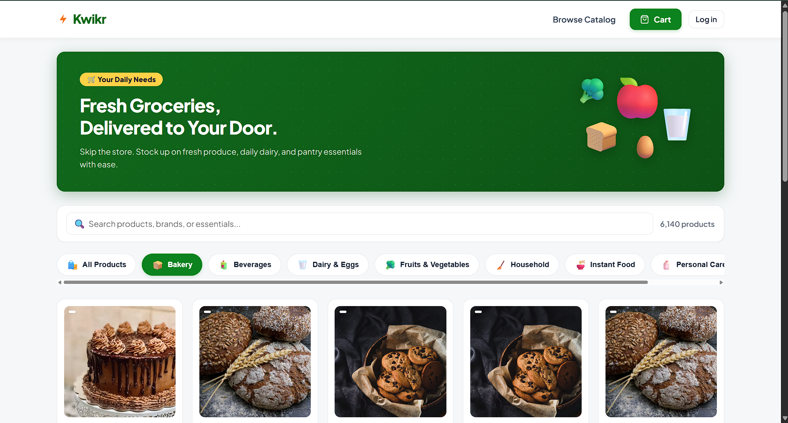
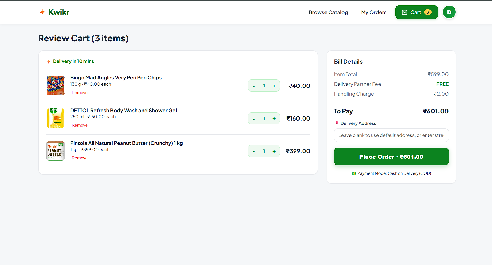
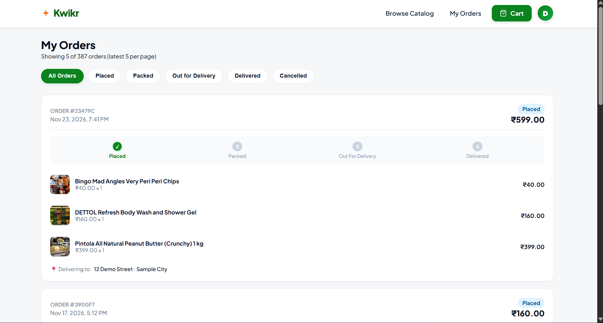
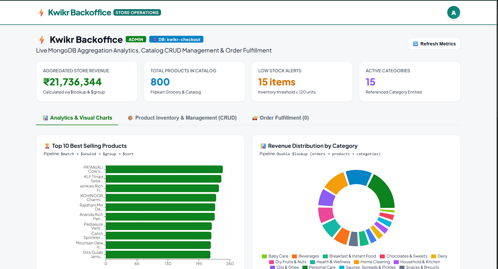
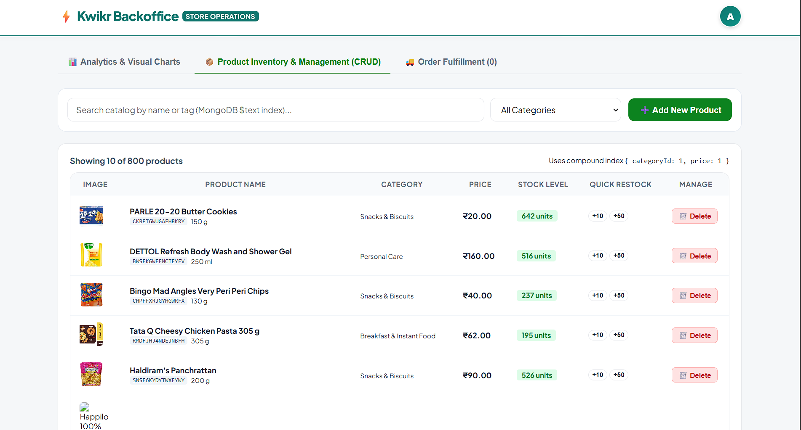
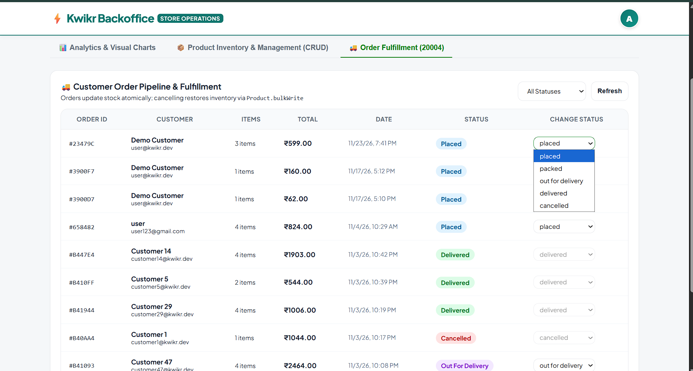
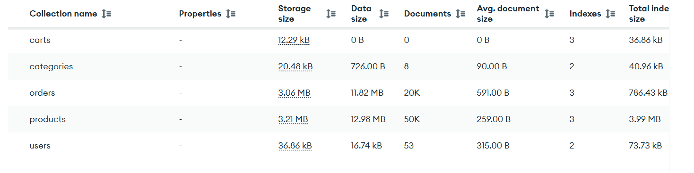
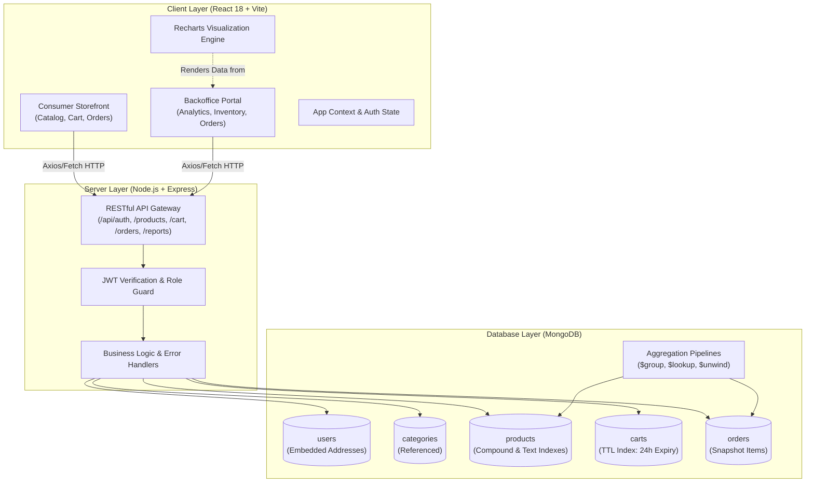

# ⚡ Kwikr — Grocery Quick-Commerce Platform

[](https://reactjs.org/)
[](https://vitejs.dev/)
[](https://nodejs.org/)
[](https://expressjs.com/)
[](https://www.mongodb.com/)
[](https://mongoosejs.com/)
[](https://recharts.org/)
[](LICENSE)

> **Kwikr** is a high-speed, full-stack MERN quick-commerce web application inspired by hyper-delivery platforms like Blinkit and Zepto. Engineered for speed and scalability, the project highlights production-ready **MongoDB data modeling patterns**, complex **aggregation pipelines**, **atomic stock management**, and clean **separation of customer and backoffice operations**.

---

## 📌 Table of Contents

- [Overview](#-overview)
- [Key Features](#-key-features)
- [Website Walkthrough & User Flows](#-website-walkthrough--user-flows)
- [Visual Showcase & Screenshot Placeholders](#-visual-showcase--screenshot-placeholders)
- [System Architecture](#-system-architecture)
- [MongoDB Data Modeling & Schema Design](#-mongodb-data-modeling--schema-design)
- [Tech Stack](#-tech-stack)
- [Getting Started & Installation](#-getting-started--installation)
- [Default Demo Credentials](#-default-demo-credentials)
- [Practical Scripts & MongoDB Demonstration](#-practical-scripts--mongodb-demonstration)
- [API Reference](#-api-reference)
- [Project Directory Structure](#-project-directory-structure)
- [Roadmap & Future Enhancements](#-roadmap--future-enhancements)

---

## 🚀 Overview

Modern quick-commerce requires sub-second response times, precise inventory locks, and instant analytical insights. Kwikr addresses these challenges through a dual-interface architecture:

1. **Customer Storefront**: An instant grocery shopping experience featuring quick category filtering, debounce-free catalog search, persistent cart sessions, and a live 4-stage order fulfillment tracker.
2. **Backoffice Operations Portal**: An operations center for dark-store managers featuring real-time charts (powered by MongoDB aggregation stages and Recharts), instant inventory controls, and live order status management.
3. **Production Database Engine**: Demonstrates enterprise NoSQL practices—combining server-side `$jsonSchema` validation, compound and text indexing, snapshot isolation for order history, atomic `$inc` updates, and TTL collection indexes.

---

## ✨ Key Features

### 🛒 Consumer Storefront
- **Instant Product Discovery**: Browse grocery items by categories (Fresh Produce, Dairy, Bakery, Beverages, Snacks, etc.) with real-time text search and price pagination.
- **Atomic Cart Operations**: Add, increment, decrement, and delete items from an active cart with real-time stock ceiling checks.
- **Historical Snapshot Checkout**: Order placement freezes current item names and purchase prices directly into the order record, ensuring historical accuracy even if catalog prices change.
- **Live Order Fulfillment Tracker**: Visual stepper interface allowing buyers to monitor orders through `Placed` ➔ `Packed` ➔ `Out for Delivery` ➔ `Delivered`.
- **Saved Delivery Addresses**: Store and select quick delivery locations with postal code tagging.

### 📊 Backoffice Store Operations & Analytics
- **Executive Analytics Dashboard**:
  - 📈 **Daily Order Volume & Revenue Trend**: Area charts tracking 14-day sales velocity.
  - 🏆 **Top-Selling SKUs**: Bar charts spotlighting top performers by volume and gross revenue.
  - 🥧 **Revenue Contribution by Category**: Multi-color pie chart visualizing department profitability.
  - ⚠️ **Low Stock Critical Alerts**: Table highlighting products below safety thresholds with 1-click reorder indicators.
  - 💡 **Key Performance Indicators (KPIs)**: Total orders, gross revenue, average order value (AOV), and catalog count.
- **Inventory & Stock Management**:
  - Live inventory table with instant inline stock adjustments (`+10`, `+50`, manual quantity edits).
  - Add new SKU modal with automatic category association and default inventory levels.
- **Order Lifecycle Management**:
  - Filter orders by status (`Placed`, `Packed`, `Out for Delivery`, `Delivered`, `Cancelled`).
  - Operational stage controls for warehouse pickers and dispatchers.

### 🧠 MongoDB & Database Excellence
- **Schema Validation (`$jsonSchema`)**: Strict database-level validation enforcing correct BSON data types, bounds, and required keys.
- **Compound & Text Indexes**: Compound indexes (`{ categoryId: 1, price: 1 }`, `{ userId: 1, createdAt: -1 }`) and `$text` indexes for instant catalog lookup.
- **Query Optimization (`explain()`)**: Preconfigured scripts proving IXSCAN performance vs. full collection scans (COLLSCAN).
- **TTL Index Lifecycle**: Automatic 24-hour expiration on abandoned carts to prevent orphaned document clutter.
- **Advanced Aggregation Stages**: End-to-end analytical reporting utilizing `$match`, `$unwind`, `$group`, `$lookup`, `$sort`, `$project`, and `$dateToString`.

---

## 🖥️ Website Walkthrough & User Flows

### 1. Consumer Journey
```text
Browse Catalog / Search ➔ Filter by Category ➔ Add to Cart ➔ Adjust Quantities ➔ 
Review Bill (Item Total + Delivery Fee) ➔ Enter Delivery Address ➔ Place Order ➔ 
Track Status (Placed ➔ Packed ➔ Out for Delivery ➔ Delivered)
```

### 2. Backoffice Operations Journey
```text
Admin Secure Login ➔ Operational Dashboard (Live KPI Metrics & Visual Trends) ➔ 
Stock Management (Identify Low Stock ➔ Inline Restock / Add New SKUs) ➔ 
Fulfillment Queue (Process Placed Orders ➔ Update Status to Packed / Out for Delivery)
```

---

## 📸 Visual Showcase & Screenshot Placeholders

Use the designated screenshot placeholders below when capturing and presenting the UI in your documentation, viva presentations, or lab reports:

---

### 1. Customer Storefront & Product Catalog
> Displays the consumer landing page with category pills, fast-delivery badge, search bar, and dynamic product cards with stock badges.

```markdown

```

<div align="center">
  <kbd>
    
  </kbd>
  <p><em>Label: <b>Screenshot 01 — Customer Storefront: Responsive Product Grid, Real-Time Search & Category Filters</b></em></p>
</div>

---

### 2. Shopping Cart & Dynamic Checkout
> Displays the cart breakdown, delivery address input, handling fee computation, and item quantity increments.

```markdown

```

<div align="center">
  <kbd>
    
  </kbd>
  <p><em>Label: <b>Screenshot 02 — Shopping Cart: Cart Item Snapshot, Delivery Address & Checkout Summary</b></em></p>
</div>

---

### 3. Customer Order Tracking & Visual Status Stepper
> Shows the customer order history page featuring the 4-phase status progress stepper (`Placed` ➔ `Packed` ➔ `Out for Delivery` ➔ `Delivered`).

```markdown

```

<div align="center">
  <kbd>
    
  </kbd>
  <p><em>Label: <b>Screenshot 03 — Customer Orders: Historical Purchases & Live Delivery Progress Stepper</b></em></p>
</div>

---

### 4. Admin Operations — Executive Analytics Dashboard
> Highlights the aggregation-driven Recharts dashboard: Top-Selling SKUs (Bar Chart), Revenue by Category (Pie Chart), and 14-Day Order Trends (Area Chart).

```markdown

```

<div align="center">
  <kbd>
    
  </kbd>
  <p><em>Label: <b>Screenshot 04 — Backoffice Analytics: MongoDB Aggregation Pipelines Visualized with Recharts</b></em></p>
</div>

---

### 5. Admin Backoffice — Live Inventory & Restock Management
> Displays the product management table with category tags, inline stock increment controls, low-stock alerts, and the SKU creation modal.

```markdown

```

<div align="center">
  <kbd>
    
  </kbd>
  <p><em>Label: <b>Screenshot 05 — Inventory Operations: Real-Time Stock Monitoring, Inline Updates & SKU Creator</b></em></p>
</div>

---

### 6. Admin Backoffice — Order Fulfillment Pipeline
> Shows store dispatch management where operators update customer orders across the delivery lifecycle.

```markdown

```

<div align="center">
  <kbd>
    
  </kbd>
  <p><em>Label: <b>Screenshot 06 — Order Fulfillment Queue: Status Transition Controls for Dark Store Staff</b></em></p>
</div>

---

### 7. MongoDB Compass / Atlas Collection & Index Architecture
> Recommended screenshot of MongoDB Compass or Atlas displaying the 5 collections, indexes, and document structure.

```markdown

```

<div align="center">
  <kbd>
    
  </kbd>
  <p><em>Label: <b>Screenshot 07 — Database Architecture: MongoDB Compass Collections, Indexes & Document Views</b></em></p>
</div>

---

## 🏗️ System Architecture



---

## 🗄️ MongoDB Data Modeling & Schema Design

Kwikr intentionally demonstrates key NoSQL schema design patterns:

| Collection | Schema Design Pattern | Technical Justification |
|---|---|---|
| **`users`** | **Embedded Subdocuments** | Shipping addresses are embedded inside the user document because they are bounded in number and always queried alongside user identity. |
| **`categories`** | **Normalized Reference** | Standard One-to-Many reference. Products store a `categoryId` `ObjectId` reference, keeping categories decoupled and independently editable. |
| **`products`** | **Indexed Document Catalog** | Implements a compound index `{ categoryId: 1, price: 1 }` for rapid category filtering with sorted prices, plus a `$text` index on `{ name: "text", tags: "text" }`. |
| **`carts`** | **Embedded Items + TTL Index** | User cart items are stored directly within the cart document. Configured with a MongoDB **Time-To-Live (TTL)** index (`updatedAt` + 24 hours) to auto-purge abandoned sessions. |
| **`orders`** | **Snapshot Embedding Pattern** | Order items store denormalized copies of product details (`name`, `price`, `qty`) at the exact millisecond of purchase. Catalog price edits never mutate past financial records. |

### Index Strategy Summary

```javascript
// products collection
db.products.createIndex({ categoryId: 1, price: 1 });
db.products.createIndex({ name: "text", tags: "text" });

// orders collection
db.orders.createIndex({ userId: 1, createdAt: -1 });
db.orders.createIndex({ status: 1, createdAt: -1 });

// carts collection (Auto-delete after 24 hours of inactivity)
db.carts.createIndex({ updatedAt: 1 }, { expireAfterSeconds: 86400 });
```

---

## 💻 Tech Stack

### Frontend
- **Framework**: [React 18](https://reactjs.org/) (Single-Page Application)
- **Bundler & Dev Server**: [Vite 5](https://vitejs.dev/) (Lightning-fast HMR)
- **Routing**: [React Router v6](https://reactrouter.com/) (Role-protected route guards)
- **Data Visualization**: [Recharts 3](https://recharts.org/) (Interactive SVG analytics charts)
- **Styling**: Modern Vanilla CSS (Custom design system, CSS Grid, Flexbox, glassmorphic accents)

### Backend
- **Runtime**: [Node.js (v18+)](https://nodejs.org/) (ES Modules)
- **Framework**: [Express 4](https://expressjs.com/)
- **Database ODM**: [Mongoose 8](https://mongoosejs.com/)
- **Authentication**: JSON Web Tokens ([jsonwebtoken](https://github.com/auth0/node-jsonwebtoken)) & [bcryptjs](https://github.com/dcodeIO/bcrypt.js)
- **Logging & Security**: [Morgan](https://github.com/expressjs/morgan), [CORS](https://github.com/expressjs/cors), [Dotenv](https://github.com/motdotla/dotenv)

---

## ⚙️ Getting Started & Installation

### Prerequisites
- **Node.js**: `v18.0.0` or higher
- **Package Manager**: `npm` (comes with Node)
- **MongoDB**: A running local MongoDB instance (`mongodb://127.0.0.1:27017`) or a free [MongoDB Atlas Cluster](https://www.mongodb.com/atlas)

---

### Step 1: Clone Repository & Setup Environment

```bash
# Clone the repository
git clone https://github.com/your-username/quickkart-mongodb.git
cd quickkart-mongodb
```

---

### Step 2: Configure & Start Server

```bash
cd server

# Create your environment variables file
cp .env.example .env
```

Edit `server/.env` with your preferred settings:

```env
MONGO_URI=mongodb://127.0.0.1:27017/kwikr
JWT_SECRET=super_secret_jwt_key_kwikr_2026
PORT=5000
SEED_PRODUCTS=50000
SEED_ORDERS=20000
```

Install dependencies, enforce schema validators, seed the database, and launch:

```bash
# Install server dependencies
npm install

# Apply server-side $jsonSchema rules to collections
npm run validate

# Seed 50,000 products, 20,000 orders, and default users
npm run seed

# Start server with Nodemon live-reload (Runs on http://localhost:5000)
npm run dev
```

---

### Step 3: Start Client Storefront

Open a separate terminal window:

```bash
cd client

# Install client packages
npm install

# Start Vite development server (Runs on http://localhost:5173)
npm run dev
```

Open **`http://localhost:5173`** in your browser.

---

## 🔑 Default Demo Credentials

Pre-populated accounts generated by the database seeder:

| Role | Email | Password | Access Level |
|---|---|---|---|
| **Store Administrator** | `admin@kwikr.dev` | `Admin@123` | Full Backoffice Portal (`/admin`), Analytics, Inventory, Orders |
| **Regular Customer** | `user@kwikr.dev` | `User@123` | Consumer Storefront (`/`), Cart, Checkout, Order Tracking |

---

## 🧪 Practical Scripts & MongoDB Demonstration

Kwikr includes executable scripts for academic presentations, vivas, and performance benchmarking:

| Command (run in `server/`) | Description | Technical Concept Illustrated |
|---|---|---|
| `npm run validate` | Applies `$jsonSchema` rules to MongoDB collections | Server-side document constraints, type validation, and required fields. |
| `npm run bson` | Creates and reads documents with varied BSON types | `ObjectId`, `Date`, `Double`, `Int32`, `Array`, `Object`, `$type` operator. |
| `npm run explain` | Benchmarks queries before & after compound indexing | Demonstrates `COLLSCAN` vs `IXSCAN`, execution time, and `totalDocsExamined`. |
| `npm run seed` | Generates large-scale test datasets (up to 50k+ docs) | Bulk document insertion, faker utilities, and indexing stress testing. |
| `npm run analytics -- top` | Analyzes top revenue products | Aggregation `$unwind`, `$group`, `$sort`, `$limit`. |
| `npm run analytics -- pairs` | Calculates frequently bought together products | Market basket analysis via nested self-joins and pairwise grouping. |
| `npm run analytics -- forecast` | Computes 7-day sales demand projection | Simple linear-trend forecasting using historical daily aggregates. |

---

## 🔌 API Reference

### 🔐 Authentication (`/api/auth`)
| Method | Endpoint | Access | Description |
|---|---|---|---|
| `POST` | `/api/auth/register` | Public | Register new customer account |
| `POST` | `/api/auth/login` | Public | Login with email/password; returns JWT token |
| `GET` | `/api/auth/me` | Authenticated | Retrieve current user profile & addresses |
| `POST` | `/api/auth/addresses` | Authenticated | Add a new delivery address |

### 🥦 Categories & Products (`/api/categories`, `/api/products`)
| Method | Endpoint | Access | Description |
|---|---|---|---|
| `GET` | `/api/categories` | Public | Fetch all grocery categories |
| `POST` | `/api/categories` | Admin | Create a new category |
| `GET` | `/api/products` | Public | Search products with `?q=`, `category=`, `page=`, `limit=` |
| `GET` | `/api/products/:id` | Public | Get single product detail |
| `POST` | `/api/products` | Admin | Create a new product SKU |
| `PATCH`| `/api/products/:id/stock` | Admin | Update current inventory stock |
| `DELETE`| `/api/products/:id` | Admin | Soft/hard delete product SKU |

### 🛒 Cart (`/api/cart`)
| Method | Endpoint | Access | Description |
|---|---|---|---|
| `GET` | `/api/cart` | Authenticated | Retrieve current user's active cart |
| `POST` | `/api/cart/items` | Authenticated | Add product to cart (`{ productId, qty }`) |
| `PATCH`| `/api/cart/items/:productId` | Authenticated | Update item quantity (`{ qty }`) |
| `DELETE`| `/api/cart/items/:productId` | Authenticated | Remove specific item from cart |
| `DELETE`| `/api/cart` | Authenticated | Clear all items from cart |

### 📦 Orders (`/api/orders`)
| Method | Endpoint | Access | Description |
|---|---|---|---|
| `POST` | `/api/orders` | Authenticated | Checkout current cart and create order |
| `GET` | `/api/orders/mine` | Authenticated | Fetch current customer order history |
| `GET` | `/api/orders` | Admin | List all orders across all users with filters |
| `PATCH`| `/api/orders/:id/status` | Admin | Transition order status (`packed`, `out_for_delivery`, etc.) |

### 📊 Admin Analytics Reports (`/api/reports`)
| Method | Endpoint | Access | Aggregation Stages Used |
|---|---|---|---|
| `GET` | `/api/reports/top-products` | Admin | `$unwind`, `$group`, `$sort`, `$limit`, `$lookup` |
| `GET` | `/api/reports/revenue-by-category` | Admin | `$unwind`, `$lookup`, `$group`, `$project`, `$sort` |
| `GET` | `/api/reports/orders-per-day` | Admin | `$match`, `$group`, `$dateToString`, `$sort` |
| `GET` | `/api/reports/low-stock` | Admin | `$match: { stock: { $lte: threshold } }`, `$sort` |
| `GET` | `/api/reports/avg-order-value` | Admin | `$group: { _id: null, aov: { $avg: "$total" } }` |

---

## 📁 Project Directory Structure

```text
quickkart-mongodb/
├── client/                     # Frontend React (Vite) Single-Page App
│   ├── public/                 # Static web assets & media
│   ├── src/
│   │   ├── components/         # Reusable UI components (ProfileMenu, modals)
│   │   ├── context/            # React Context (Auth, Cart, Toast notifications)
│   │   ├── pages/
│   │   │   ├── Admin.jsx       # Backoffice portal (Analytics, Inventory, Orders)
│   │   │   ├── AdminLogin.jsx  # Dedicated operational admin login
│   │   │   ├── Cart.jsx        # Shopping cart review & checkout
│   │   │   ├── Login.jsx       # Customer login & registration
│   │   │   ├── Orders.jsx      # Customer order history & live stepper
│   │   │   └── Products.jsx    # Consumer product catalog & search
│   │   ├── utils/              # Product image mappers & visual helpers
│   │   ├── api.js              # Centralized API fetch client with JWT headers
│   │   ├── App.jsx             # Role-based route definitions & layout wrappers
│   │   ├── main.jsx            # React root mount
│   │   └── styles.css          # Core design system & responsive styling
│   ├── index.html              # HTML entrypoint
│   ├── package.json            # Client scripts & dependencies
│   └── vite.config.js          # Vite build configuration
│
├── server/                     # Backend Node.js / Express / Mongoose API
│   ├── src/
│   │   ├── config/
│   │   │   ├── db.js           # Mongoose MongoDB connection handler
│   │   │   └── jsonSchemas.js  # Native MongoDB $jsonSchema validation rules
│   │   ├── middleware/
│   │   │   ├── auth.js         # JWT verification & admin guard middleware
│   │   │   └── error.js        # Global HTTP error handler
│   │   ├── models/             # Mongoose schemas & index definitions
│   │   │   ├── Cart.js         # Embedded cart items with TTL index
│   │   │   ├── Category.js     # Normalized category schema
│   │   │   ├── Order.js        # Snapshot items and order status lifecycle
│   │   │   ├── Product.js      # Compound & text indexed catalog
│   │   │   └── User.js         # User model with embedded addresses
│   │   ├── routes/             # Express API endpoint controllers
│   │   │   ├── auth.js         # Customer & admin authentication
│   │   │   ├── cart.js         # Atomic cart manipulation
│   │   │   ├── categories.js   # Category management
│   │   │   ├── orders.js       # Order creation & fulfillment transitions
│   │   │   ├── products.js     # Product querying & stock adjustments
│   │   │   └── reports.js      # Complex aggregation analytics pipelines
│   │   ├── scripts/            # CLI utilities for testing & practicals
│   │   │   ├── analytics.js    # Aggregations, pairs & linear forecasting
│   │   │   ├── applyValidation.js # CLI to enforce $jsonSchema on collections
│   │   │   ├── bsonDemo.js     # BSON data types demonstration
│   │   │   ├── explain.js      # Query execution stats (COLLSCAN vs IXSCAN)
│   │   │   └── seed.js         # High-volume synthetic data seeder
│   │   └── index.js            # Express app entrypoint & middleware bootstrap
│   ├── .env.example            # Sample environment variables
│   └── package.json            # Server scripts & dependencies
│
├── docs/
│   └── PRACTICALS.md           # MongoDB academic syllabus checklist & viva guide
└── README.md                   # Project documentation
```

---

## 🗺️ Roadmap & Future Enhancements

- [ ] **Multi-Document ACID Transactions**: Wrap checkout and stock decrement in `session.withTransaction()`.
- [ ] **Real-Time Order Tracking with Change Streams**: Stream database updates straight to the client with MongoDB Change Streams and WebSockets.
- [ ] **Dark-Store Geolocation (`$near` / `$geoWithin`)**: Introduce multi-warehouse geospatial indexing to assign orders to the nearest hub.
- [ ] **Wishlists & Saved Baskets**: Implement many-to-many relationship modeling.
- [ ] **Automated Payment Gateway Integration**: Connect Razorpay / Stripe sandbox webhooks.

---

## 📄 License

This project is licensed under the **MIT License**. Feel free to use it for academic coursework, practical exams, personal development, or project demonstrations.
